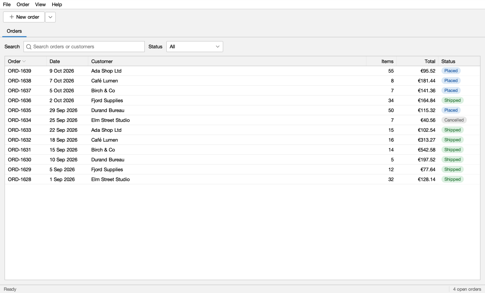

# Order Desk

The demo app of [swing-ui-agent](https://github.com/kormcrete/swing-ui-agent): a small Swing order desk where a shop
employee takes an order for a customer, made for a coding agent to drive and test. It has the parts real Swing
business apps have:

- closable tabs and a status bar;
- sortable, filterable tables, and a cart with an editable quantity spinner;
- a category tree, popup and context menus, keyboard shortcuts;
- a four-step checkout wizard with rules (credit limit, missing postal code, shipping and payment options);
- a background task, confirm dialogs, a file chooser, and a light and a dark theme.

Java 8, FlatLaf, MigLayout. Customers, products and orders are invented and live in memory: each start begins with the
same data.

**Status:** the app is complete; swing-ui-agent, which it demonstrates, is pre-release (`0.1.0-SNAPSHOT`).



**Tour and recorded test on the site: https://kormcrete.github.io/swing-ui-agent/demo/tour/**

## Download

Try it without building anything: each download includes Java (Zulu JRE 8) and starts Order Desk with the agent on
port 8770.

| Your computer | Download |
|---|---|
| Mac with Apple Silicon (M1 and later) | [kormcrete-order-desk-macos-arm64.dmg](https://github.com/kormcrete/swing-order-desk-demo/releases/latest/download/kormcrete-order-desk-macos-arm64.dmg) |
| Mac with Intel | [kormcrete-order-desk-macos-x64.dmg](https://github.com/kormcrete/swing-order-desk-demo/releases/latest/download/kormcrete-order-desk-macos-x64.dmg) |
| Windows (x64) | [kormcrete-order-desk-windows-x64.zip](https://github.com/kormcrete/swing-order-desk-demo/releases/latest/download/kormcrete-order-desk-windows-x64.zip) |

The downloads are not signed yet, so the first launch takes a few extra clicks:

- **macOS:** open the `.dmg` and drag **Kormcrete Order Desk** to Applications. The app is not notarized by Apple yet,
  so macOS refuses to open it ("Apple could not verify…"). Clear the download mark once, in Terminal, then open it:

  ```bash
  xattr -dr com.apple.quarantine "/Applications/Kormcrete Order Desk.app"
  ```

- **Windows:** unzip, open the **Kormcrete Order Desk** folder and run **Kormcrete Order Desk.exe**. If SmartScreen
  stops it, click **More info → Run anyway**.

Then connect your coding agent while the app runs:

```bash
claude mcp add --transport http order-desk http://127.0.0.1:8770/mcp
```

Other MCP clients: [MCP clients](https://kormcrete.github.io/swing-ui-agent/agents/mcp-clients/). If your agent cannot
connect, another app may be using port 8770; the agent's log says so: `~/Library/Logs/Kormcrete Order Desk/agent.log`
(macOS), `%LOCALAPPDATA%\Kormcrete Order Desk\agent.log` (Windows).
If the app does not open at all on macOS, the reason is in `~/Library/Logs/Kormcrete Order Desk/order-desk.log`
(for example an Intel Mac with the Apple Silicon download).

## Build

swing-ui-agent is not on Maven Central yet. Clone both repositories side by side and install it first:

```bash
git clone https://github.com/kormcrete/swing-ui-agent.git
git clone https://github.com/kormcrete/swing-order-desk-demo.git
(cd swing-ui-agent && mvn -B install -DskipTests)
cd swing-order-desk-demo && mvn -B package
```

## Run it in IntelliJ

Open the folder in IntelliJ. Its run configurations are ready to use:

- **Order Desk:** the app with the agent on port 8770 and the palette (the bar for recording a test yourself;
  `palette=off` leaves it out for agent-only runs).
- **UI tests:** every `@UiTest` class (JUnit tag `ui`), against the running app. The gutter icons work too.
- **All tests:** the unit tests (tag `!ui`), no app needed.

To record a test: run **Order Desk**, press **● Record** in the palette, use the app, add checks with
**Check**, press **Done**, then **Export…** to write the JUnit class into `src/test/java`. Step by step:
https://kormcrete.github.io/swing-ui-agent/start/intellij/

## Start it from a shell

```bash
java -javaagent:target/swing-ui-agent-agent.jar=port=8770 -Dorderdesk.today=2026-10-12 -jar target/order-desk.jar
```

- `-javaagent:…` lets a coding agent, or the UI tests, drive the app on port 8770. Without it, Order Desk is a normal
  app.
- `-Dorderdesk.today=2026-10-12` fixes the date the app uses, so every run looks the same.
- The palette (recording bar) is on by default; add `,palette=off` after the port for agent-only runs.

## Drive it with a coding agent

Your coding agent drives the running app through the agent jar's command line, one call per step:

```bash
UI="java -jar target/swing-ui-agent-agent.jar --port 8770"
$UI snapshot '{"window":"main","depth":3,"compact":true}'
$UI click '{"target":{"role":"button","name":"New order for a recent customer"}}'
$UI pick '{"path":["Ada Shop Ltd"]}'
```

Give your agent the skills in swing-ui-agent's
[`skills/`](https://github.com/kormcrete/swing-ui-agent/tree/main/skills) folder first. With Claude Code:
https://kormcrete.github.io/swing-ui-agent/start/claude-code/

## The recorded tests

[`PlaceOrderUiIT`](src/test/java/io/github/kormcrete/orderdesk/PlaceOrderUiIT.java) takes an order for Ada Shop Ltd
from File ▸ New order through checkout to the placed order, with a 2x screenshot after each step.
[`CartTotalsUiIT`](src/test/java/io/github/kormcrete/orderdesk/CartTotalsUiIT.java) fills Ada's cart with 3 × A4
paper and 10 × Gel pen, checks a line total and the €31.32 total, and discards the cart; the swing-ui-agent home page
plays its recording and replay.

- **Made by an agent:** it drove the app through the command line and exported the tests; a person reviewed them.
- **Run them:** with the app running, use **UI tests** in IntelliJ or `mvn -B -Pui verify`. The tests find the agent
  through `src/test/resources/junit-platform.properties`. `mvn -B verify` runs only the unit tests.
- **In CI:** the `build` workflow runs them under Xvfb and uploads the screenshots as the `ui-screenshots` artifact.

Walkthrough: https://kormcrete.github.io/swing-ui-agent/demo/recorded-test/

## Things to try

- ▾ next to New order, then Ada Shop Ltd: a New order tab with Ada's account terms next to the Customer field.
- Add 3 × A4 paper and 10 × Gel pen, black: the 5% volume discount appears and the cart total is €31.32.
- Checkout… with Standard shipping and a PO number: the review shows €37.20, and Place order makes order ORD-1640.
- Birch & Co with an Espresso machine on invoice: the credit limit warning, then Pay by card instead.
- Elm Street Studio at checkout: the postal code is missing, so Next stays disabled until it is filled in.
- Café Lumen at checkout: no Express to the Netherlands, and Café Lumen pays by card only.
- 5 Staplers when 4 are in stock: the cart says so and Checkout… stays disabled; the Desk lamp cannot be added.
- The Orders tab: search for "birch", filter by status, right-click an order to cancel it.
- An order's tab: Save receipt… writes a plain-text receipt through a file chooser.
- File ▸ Close tab, ⌘W (Ctrl+W elsewhere) and File ▸ Exit, which ask first while a cart has products.
- View ▸ Theme ▸ Dark and back.

## License

Apache-2.0, see [LICENSE](LICENSE) and [NOTICE](NOTICE). The libraries bundled in `order-desk.jar` and their
licenses are listed in `META-INF/THIRD-PARTY-NOTICES.txt` (in the jar, and in `src/main/resources`).
